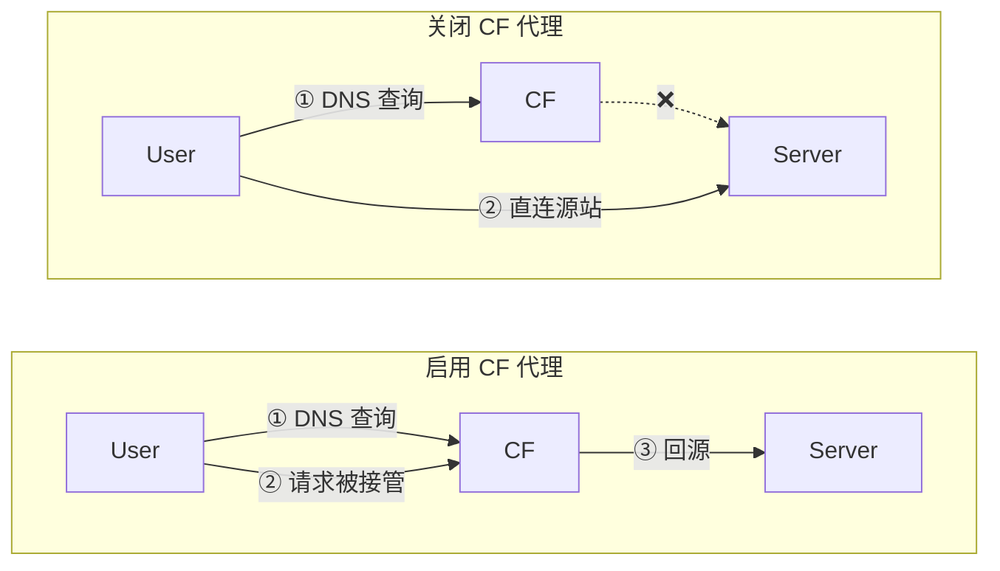
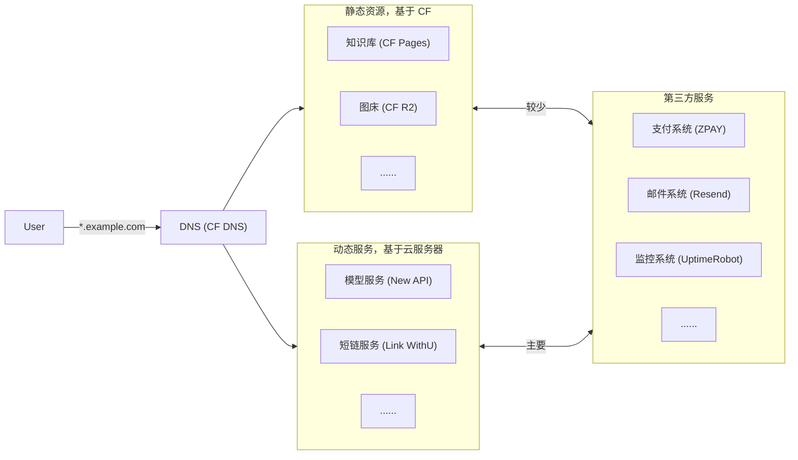

很多时候我们需要一台 7*24 待命的机器托管我们的服务，鉴于本地门槛较高（场地、稳定性、安全性等），此时付费使用云服务商提供的服务是一个不错的选择。

本文主要围绕 Cloudflare（后简称 CF）生态介绍云服务的相关产品以及使用方法。

## 域名

域名用于包装服务器的 IP 地址，用户在访问域名时，[Name Server](../../base/cs/computer-network/application-layer.md#dns-协议) 会将域名转换为 IP，进而提供服务。每家域名供应商几乎都会定义自己的 Name Server。

### 域名选择

域名是你提供服务的入口，隐藏了难以记住的服务器 IP。常见的域名供应商有阿里云万网、Spaceship 等。CF 也提供了域名注册服务。

### 域名接入 CF Domain

为了使用 CF 的一系列云上基础设施，我们需要将在其他地方注册购买的域名接入 CF Domain，原理就是把域名的 Name Server 修改为 CF 的 Name Server。

操作上，进入 CF 的 dashboard 后，进入 `Domains` >> `Overview` >> `Add domain` >> `Connect a domain`。之后按照教程，选择 Free Plan，然后到域名注册商那里把 Name Server 修改为 CF 提供的 Name Server，就算接入成功了。

### 域名解析 CF DNS

接入成功后，就可以进入域名栏目进行常规的域名操作。最重要的一步就是 [DNS](../../base/cs/computer-network/application-layer.md#dns-协议) 解析，即把你的域名绑定到对应的服务上（最常见的绑定到你服务器的公网 IP 地址）

只要域名解析时启用了 CF 的流量代理（就是在域名解析时点亮了小橙云），就可以享受 CF 提供的各种便捷服务了。是否启用流量代理的区别如下：

### 加密证书 CF SSL

如果启用了 CF 的流量代理，就可以使用免费且自动续签的 Edge SSL 证书和 Origin SSL 证书。前者解决客户端到 CF 代理的加密，后者解决 CF 代理到源服务器的加密。后续我们只需要把 Origin SSL 配置在服务器即可。CF Origin SSL 最方便的地方在于，其可以申请长达 15 年的证书，期间不需要操心进行任何证书续签的事。

## 静态资源

### 静态页面 CF Pages

[CF Pages](https://developers.cloudflare.com/pages/) 提供了免费的静态网页托管服务，结合 CF 的防护，可以实现零成本、高安全的网页托管。

为了便于 CI/CD，我推荐使用 [GitHub](./github.md) 托管代码，CF 可以自动检测更新并运行构建命令发布或更新网页。基本逻辑如下：

1. 进入 `Compute` >> `Workers & Pages` >> `Create application` >> `Deploy Pages`。
2. 如果没有高频迭代需求，可以直接把网页拖拽进去，否则选择 Import Git Repostory。
3. 接下来连接 GitHub 的仓库并配置构建命令。
4. 启动部署后过一段时间就可以看到你的静态网页被托管在了 `xxx.pages.dev` 上。

后续如果在 GitHub 更新了代码，CF Pages 会自动检测到变化并重新构建发布，整个 CI/CD 流程对开发者完全透明，非常方便。另外也可以在 Metrics 中启用 CF Web Analytics，以及在 Custom domains 中自定义域名。

### 对象存储 CF R2

[CF R2](https://developers.cloudflare.com/r2/) 提供了便捷的对象存储服务，但是需要提供付费方式才能使用，实测绑定 PayPal 后就可以正常使用，别的方法就八仙过海各显神通了。

对于可使用的用户，CF R2 提供了 10GB 的免费存储空间以及每月一定次数 CRUD 的操作，在个人或小型业务场景下完全足够。此外，CF R2 也支持自定义域名以达到资源 CDN 的效果。最重要的是，CF R2 的所有上下行流量均免费。

## 动态服务

### 服务器选择

如果你需要一台机器 24 小时运行你的应用，云服务器是不二选择。目前支付友好的平台除了国内的阿里云、腾讯云等，还有国外的 DigitalOcean。各种二三流的云服务器平台需要读者自行承担跑路风险。

新手推荐购买阿里云新用户的 2C2G3M 云服务器，前两年都只要 99 元。老手想必都有自己的路子，就不多赘述。

### 服务管理 Docker Compose

连接上云服务器后就可以部署自己的应用了。笔者习惯使用 [docker compose](./docker/index.md) 部署应用同时把数据保存在项目目录而非 docker volume，因为这方便管理和快速迁移。代价就是需要把应用打包到 docker hub 之类的软件平台，读者可以选择自己熟悉的方式部署应用。

### 网关管理 Nginx

应用部署好以后，还需要使用 Nginx 把服务端口和域名绑定，确保流量能够正确代理到对应的应用。同时需要在 CF Domains 申请一张 Origin SSL 证书并安装到服务器上，目前 CF 提供最长 15 年的 Origin SSL，安装一次以后开发者就无需操心 SSL 证书的更新了。读者可移步 [Nginx](./nginx/index.md) 文档作进一步了解。

最后，你需要在云平台把服务器的 443 端口放通，确保用户可以通过 HTTPS 协议访问到你的服务。

## 第三方服务

### 状态监控

UptimeRobot

### 日志服务

Resend

### 支付服务

ZPAY

### 用户分析

[CF Web Analytics](https://developers.cloudflare.com/web-analytics/) 提供了开箱即用的网页监控服务，启用后会自动在页面注入 JS 脚本用来统计用户信息与网页流量。

其他选项还包括 Google Analytics、百度统计等，但都需要自己把监测脚本写到 Web 里。另外百度统计只能保存一年的信息，如果有条件使用 CF Web Analytics 和 Google Analytics 就不要考虑百度统计了。

## 案例分析

综合考虑成本、可维护性、可迭代性，笔者总结出了一套相对成熟的方案，适合个人捣鼓：

其中运维量最大的就是动态服务模块。笔者总结的方案是，所有的服务尽可能选择支持 Docker 部署的，然后把所有的项目全部放在同一个文件夹，好处如下：

- 便于迁移：数据搬家时，直接基于 CF R2 把数据中转到新服务器即可，前提是把服务的数据保存到子文件夹而不是  docker volume。
- 便于管理：每个服务都本地部署并通过 Nginx 把服务反代到服务器公网的 443 端口，不仅安全而且很方便。
